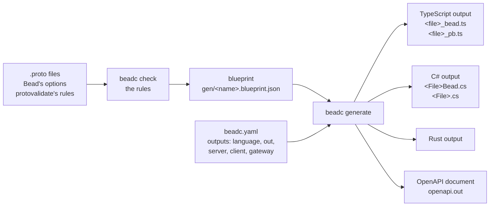
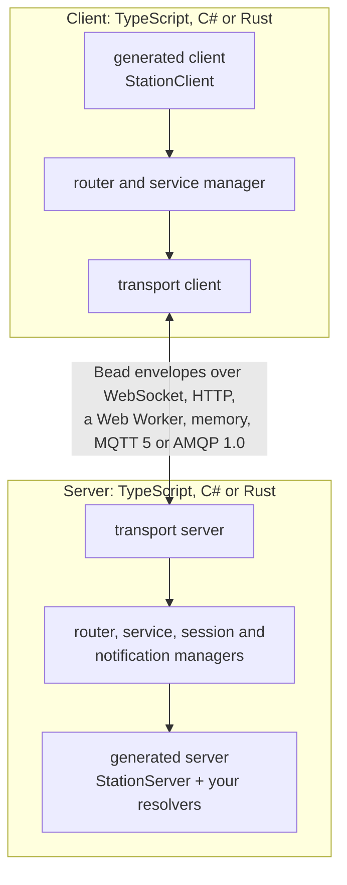
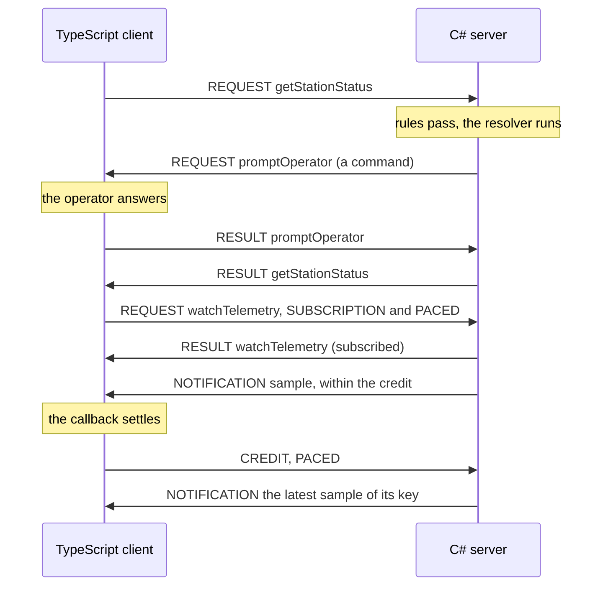

# How Bead fits together

The mental model a team needs before it adopts Bead: what it writes, what beadc makes of it, what
runs, and where Bead stands beside gRPC-Web, Connect and SignalR.

> **Nothing is published yet.** beadc's image is built from a clone of Bead at a pinned commit,
> and the runtimes come from that clone by path; [the support matrix](../support.md) says what each
> side plays today and what is ahead.

## From a `.proto` to what runs

A team writes three things: the `.proto` that declares its services, `beadc.yaml`, which says what
each language gets, and the resolvers and calls. beadc writes everything between them.

- **The `.proto`** is the contract. Bead's options, `import "bead/options.proto";`, give each
  service and each procedure an id the wire carries in place of its name, say whether a procedure
  is a plain request, a request that opens a subscription (`notifies`) or a command the server
  sends its client (`command`), and who is admitted. protovalidate's rules on a request's fields
  are compiled into each side, so a request they refuse is answered `PAYLOAD_INVALID` before its
  resolver runs. `stream` is Bead's own and refused in a `.proto`.
- **The blueprint** is the contract as beadc reads it, one JSON file, deterministic: what
  `beadc breaking` compares against an earlier one to find a change that breaks the wire or the
  API.
- **`beadc.yaml`** cuts the blueprint into outputs, one per language and folder: a whole service,
  its server half alone (`server: {}`), its client half alone (`client: {}`), a gateway that
  answers its procedures over HTTP and JSON (`gateway: {}`), a selection of procedures. A key
  beadc does not read is refused.
- **Each output** is a typed server class, where a team writes only resolvers, and a typed client
  class, beside the messages protoc's plugins write: protoc-gen-es for TypeScript, protoc for C#,
  Buffa for Rust.

Each file and option is in [the builder's README](../../builder/README.md); the
[getting-started guide](getting-started.md) runs the whole path.

## What runs

At run time, a generated service is offered on a server, which runs a router on a transport. The
client is the same three layers, the other way round.

- **The envelope** is Bead's unit on the wire: an 8-byte prefix whose first byte is the layout,
  `0xA1`, then a header at fixed big-endian offsets, so a router or a relay reads what an envelope
  is, which call it belongs to and how long it is without decoding its payload
  ([the specification](../../spec/spec.md)).
- **The transports** carry the same envelopes: WebSocket, plain HTTP where WebSocket cannot pass,
  a Web Worker in the page, memory between two routers of one process, and a broker, MQTT 5 or
  AMQP 1.0. Which side has which is a row of [the support matrix](../support.md).
- **The implementations** play the same conformance files and call each other in CI, so a C#
  server and a TypeScript client, as in the getting-started guide, are one protocol.

## One call, one command, one paced subscription

The three kinds of call the getting-started project makes, as envelopes. A command is a request
the server makes, on an even call id; a client's calls are odd.

A paced subscription's request is its first credit. Past its credit, a notification waits in its
subscription's queue, and one of the same key replaces the one waiting; a queue past its bounds,
64 notifications or 1 MiB by default, ends the subscription `CAPACITY_EXCEEDED` rather than drop
anything in silence.

## Bead beside gRPC-Web, Connect and SignalR

Each cell is what Bead's sources say of Bead, or what the other project's own documentation, linked
below the table, says of it. A cell that reads "not stated" means the pages linked do not say;
it claims nothing either way.

| What a team asks                             | Bead                                                                                                                          | gRPC-Web                                                                                     | Connect                                                                                                                                                | SignalR                                                                                        |
| -------------------------------------------- | ----------------------------------------------------------------------------------------------------------------------------- | -------------------------------------------------------------------------------------------- | ------------------------------------------------------------------------------------------------------------------------------------------------------ | ---------------------------------------------------------------------------------------------- |
| Where is the contract?                       | A `.proto` with Bead's options                                                                                                | `.proto` definitions, from which protoc generates the messages and the client stub           | A Protocol Buffer schema, from which the client is generated                                                                                           | Hub classes in .NET; a strongly typed `Hub<T>` checks client methods at compile time           |
| How does a browser reach the server?         | WebSocket or plain HTTP, with no translating proxy; TLS stands in front of the server                                         | "via a special proxy; by default, gRPC-web uses Envoy"                                       | Connect's own protocol, or gRPC-Web for an endpoint that speaks only it; its servers take gRPC-Web "without relying on a translating proxy like Envoy" | WebSockets, then Server-Sent Events, then Long Polling, "in order of graceful fallback"        |
| What does the server push to a browser?      | Notifications of a subscription                                                                                               | Server streaming: "gRPC-web currently supports 2 RPC modes", unary and server-side streaming | In a browser, "you can use streaming from the browser, but only server streaming"                                                                      | Messages to a client, a group or all; server-to-client streams                                 |
| Can the client pace what it is sent?         | Yes: a window of credit per subscription; a waiting notification is replaced by a newer one of its key                        | Not stated                                                                                   | Not stated                                                                                                                                             | Not stated                                                                                     |
| Can the browser send a stream?               | A transfer: a large payload in chunks, under the receiver's credit                                                            | "Client-side and Bi-directional streaming is not currently supported"                        | "browser vendors have not come to an agreement to support streams from the client"                                                                     | Client-to-server streaming                                                                     |
| Can the server call the client and await it? | Yes: a command, mid-call, answered by the client's resolver                                                                   | Not stated                                                                                   | Not stated                                                                                                                                             | Yes: client results, `InvokeAsync` on `Client(…)` or `Caller`                                  |
| Are requests checked against rules?          | Yes: protovalidate's rules, a first set, compiled into each side; `PAYLOAD_INVALID` before the resolver                       | Not stated                                                                                   | Not stated                                                                                                                                             | Not stated                                                                                     |
| What is on the wire?                         | A binary envelope at fixed offsets; its payload `raw`, `text`, `json` or `proto`                                              | `grpc-web-text` by default; binary protobuf, "Only unary calls are supported"                | Binary Protobuf or JSON                                                                                                                                | JSON by default, or MessagePack                                                                |
| After a dropped connection?                  | The application calls `reconnect`; each subscription is dropped and told, and the application subscribes again                | Not stated                                                                                   | Not stated                                                                                                                                             | `withAutomaticReconnect()`, off by default: 0, 2, 10 and 30 s, then stops; a new connection id |
| Which languages?                             | TypeScript and C# at parity; Rust: its core, WebSocket, HTTP and MQTT 5, each part it lacks a row of the support matrix ahead | "A JavaScript implementation of gRPC for browser clients"                                    | Go, TypeScript and JavaScript, Swift, Kotlin, Python, Rust, Dart                                                                                       | An ASP.NET Core server; clients by platform                                                    |
| How is it installed?                         | From a clone at a pinned commit; nothing is published                                                                         | From npm, `grpc-web`                                                                         | From npm, `@connectrpc/connect` and `@connectrpc/connect-web`                                                                                          | The JavaScript client from npm, `@microsoft/signalr`                                           |

The other projects' cells quote or sum up their own pages: gRPC-Web's
[README](https://github.com/grpc/grpc-web); Connect's [introduction](https://connectrpc.com/docs/introduction),
[protocol](https://connectrpc.com/docs/protocol) and [web client](https://connectrpc.com/docs/web/getting-started);
SignalR's [overview](https://learn.microsoft.com/en-us/aspnet/core/signalr/introduction),
[hubs](https://learn.microsoft.com/en-us/aspnet/core/signalr/hubs),
[streaming](https://learn.microsoft.com/en-us/aspnet/core/signalr/streaming) and
[JavaScript client](https://learn.microsoft.com/en-us/aspnet/core/signalr/javascript-client).
Bead's cells come from [the root README](../../README.md), [the support matrix](../support.md),
[the builder's README](../../builder/README.md) and the implementations' READMEs.

**When Bead fits.** A client and its server hold a conversation rather than trade messages: a
dashboard that follows state as it changes and must not fall behind, a back office whose server
needs to ask the client something mid-call, an app that uploads large files while it keeps
working, calls that cross a topic-based broker that already joins services and devices. A browser
speaks it with no translating proxy in between, and the TypeScript, C# and Rust sides keep one
behaviour.

**What to weigh before adopting it.** Bead's packages are not published yet: a team builds
beadc's image and takes the runtimes from a clone at a commit it pins. What each side plays, and
what is ahead, is in [the support matrix](../support.md). A team whose services already speak gRPC
behind a gRPC-Web proxy, or whose .NET hubs are already its contract, weighs that against moving
its calls onto a new protocol.
