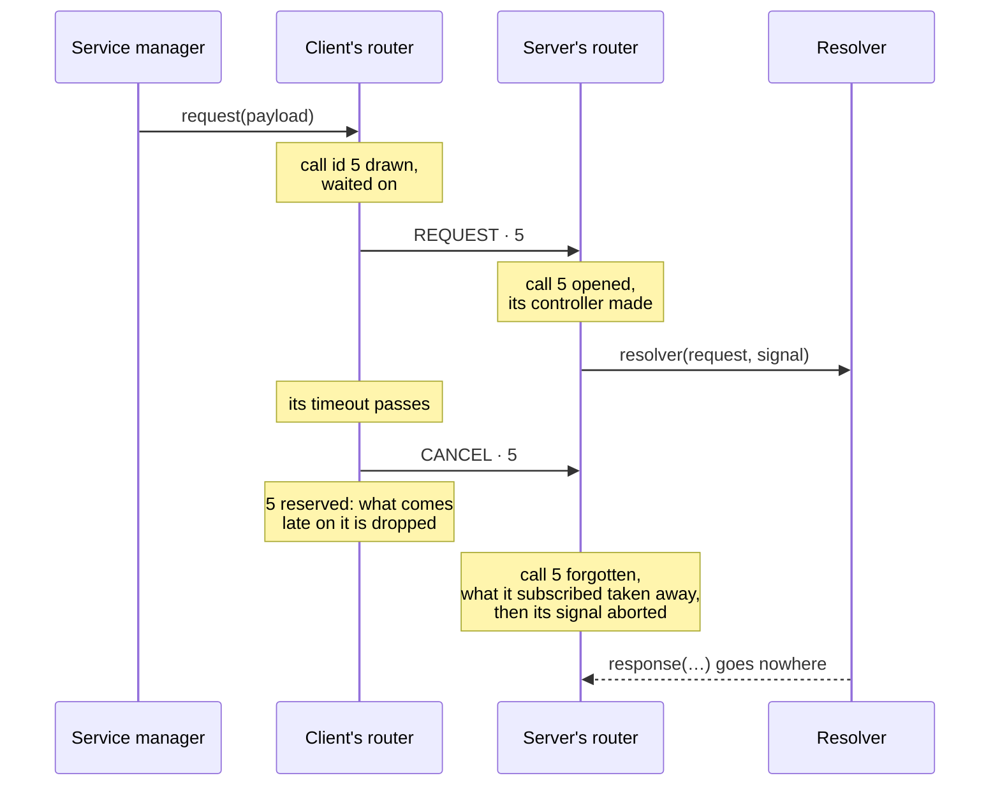
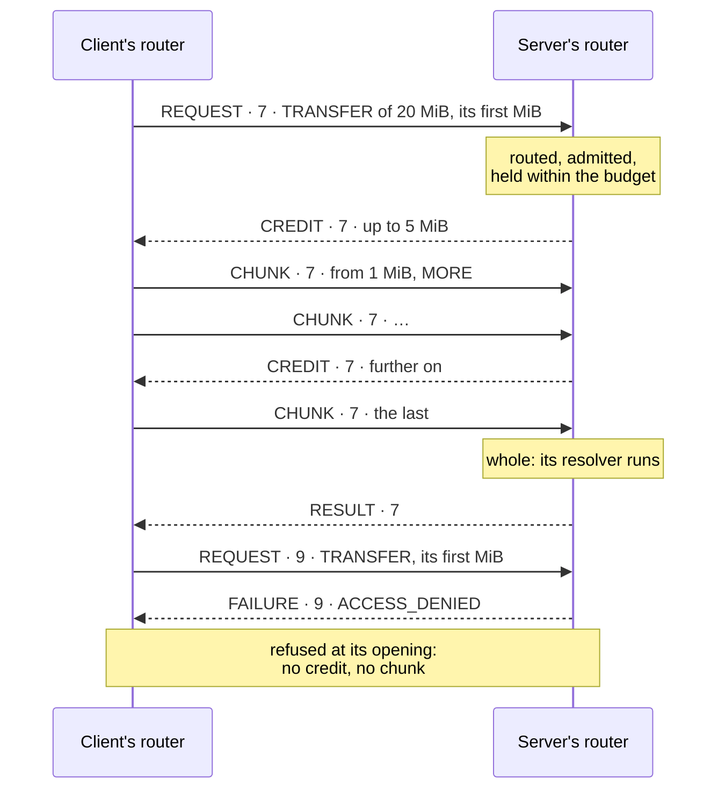
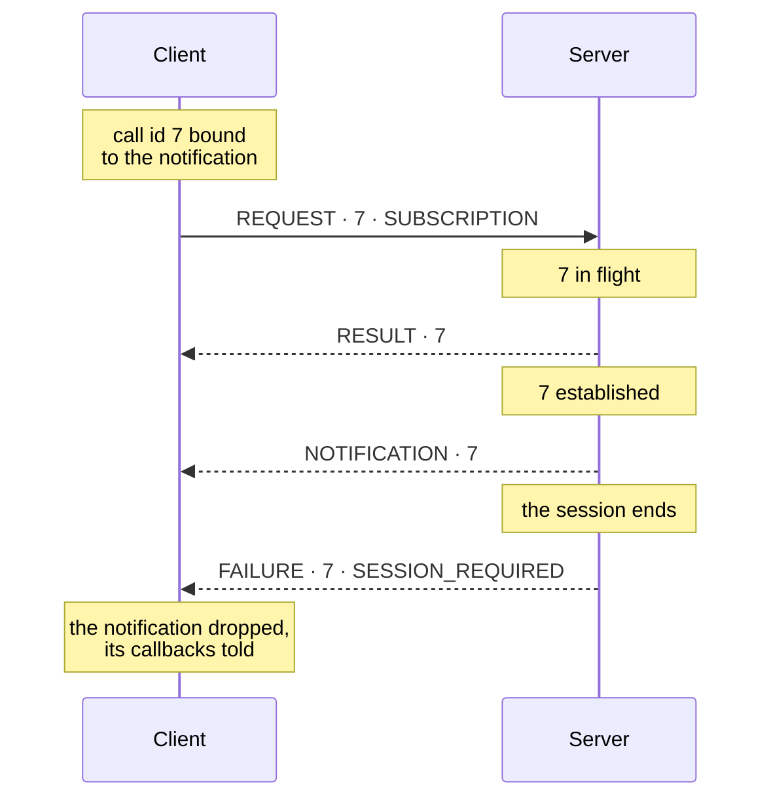
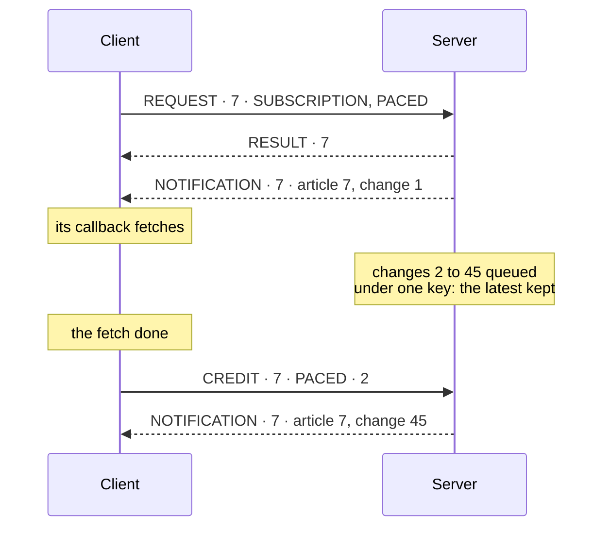
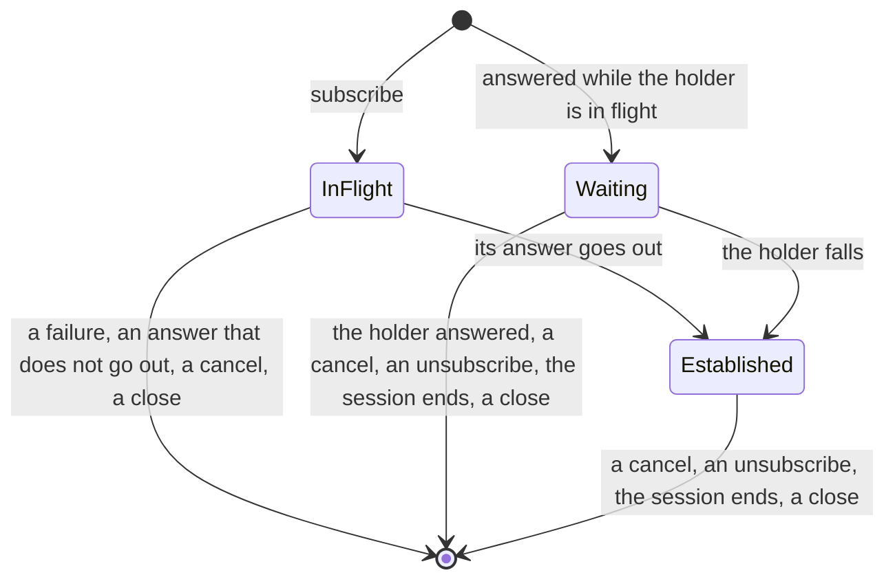

# Bead, on the TypeScript side

Bead is a binary wire protocol: the envelopes of a request, its result or failure, the
notifications of a subscription and the commands a server sends back, written at fixed offsets.
This project is its TypeScript implementation — a WebSocket, an HTTP and a Web Worker transport,
each a client and a server, a client and a server router over them, the service, session and
notification managers, and the client and server that put the three layers together. Nothing in
it imports a framework at run time. The specification and the conformance files both sides play
are in [`spec/`](../../spec/).

```ts
import { createWSTransportClient } from '@francisdesjardins/bead/ws-transport-client';
import { createWSTransportServer } from '@francisdesjardins/bead/ws-transport-server';
import { createHTTPTransportClient } from '@francisdesjardins/bead/http-transport-client';
import { createHTTPTransportServer } from '@francisdesjardins/bead/http-transport-server';
```

## The transport

`transport-client`, `ws-transport-client`, `transport-server` and `ws-transport-server` are the
first layer of a transport → router → service stack, which is why they sit together under
`src/transport/`, split the way the rest is: `client/`, `server/`, and the `shared/` both stand on.

Each end — client or server — has a shared half and a transport. The shared half owns the events and the guards
around the life of the connection — `reconnect` and the drop behind `await using` for a client, `start` and `stop`
and the connection registry for a server. The transport supplies what only it knows: how to open,
close and send on the wire. WebSocket is the first, HTTP the second — see [HTTP](#http); another
transport supplies its own.

The client runs on the global `WebSocket` — every browser, and Node 24, the package's floor — or on
any constructor passed as `WebSocket`, which is how `ws` plugs in; its suite runs on both. The
server has no global to fall back on, so it always takes `ws`'s `WebSocketServer`, and its suite
talks to it through the client, on both.

Each WebSocket end beats: every `heartbeat` milliseconds — 30,000 by default, `Infinity` for none —
it sends WebSocket's own PING control frame (RFC 6455 §5.5.2), and drops a connection that left the
one before unanswered, whose `close` then says it was not clean. A peer gone without a word — a
cable pulled, a machine asleep, a NAT that forgot — ends in a `close` within two beats rather than
never. A browser's socket cannot ping, but answers the server's pings by itself, so the server's
heartbeat covers it; the client beats over `ws`. A heartbeat keeps nothing of a session alive: a
session's timers count what the peer says, not that it answers. Bead has no ping of its own: whether
a connection is alive is its transport's to know.

```ts
import { WebSocketServer } from 'ws';

const server = createWSTransportServer({ WebSocketServer });
server.on('message', ({ data }, connectionHandle) => {
  void server.send({ data }, connectionHandle);
});
const { port } = await server.start({ findOpenPort: true });

const client = createWSTransportClient();
client.on('close', (clean) => {
  if (!clean) {
    client.reconnect({ signal: AbortSignal.timeout(30_000) }).catch((reason: unknown) => {
      console.error(reason);
    });
  }
});
await client.connect({ host: 'localhost', port });
await client.send({ data: 'hello' });
```

What a transport carries, both ways, is a message, `{ data, credential }`: an envelope, and the
credential the transport carries beside it, which a request presenting `ELSEWHERE` stands for. Over
HTTP it is the `Authorization` of the `POST` that carries a request — see [HTTP](#http); a WebSocket
and a Web Worker carry none, either way. Each end says what it can carry, so its router fails before
it goes a call whose credential it cannot: `carriesCredential`, and `isSecure`, judged by what the
end was given, never by what a name resolves to — a client by the URL of its connect, under TLS
(`wss`, `https`) or to a loopback host (`localhost`, a name in `.localhost`, 127.0.0.0/8, `::1`); a
server, per connection, by what it listens on — a loopback host, or, over HTTP, a server under TLS —
and nothing tells it that TLS stands in front of it; a worker always, since it never leaves the
machine.

Each end takes its time from a `clock`: the part of the globals Bead calls — `setTimeout`,
`clearTimeout`, `setInterval`, `clearInterval`, `Date.now` and `performance.now` — in their own
shape, so the platform's, `globalThis`, is the default, and `@sinonjs/fake-timers`' `createClock()`,
never installed on the globals, is a test's. A stack has one clock, set where it starts and read
upward: a router or a server built on a transport runs on the transport's, a server's sessions on
the server's, a service manager on its router's, and one given that differs is a `ProgrammerError`.
Each transport, router and session manager exposes the one it runs on as `clock`. What bounds a
platform's own close stays on the real clock — a ping, the WebSocket server's close handshake, the
HTTP client's disconnect. A timeout past `LONGEST_TIMER`, 2³¹ − 1 milliseconds, is refused wherever
one is taken; never is `Infinity`, which arms nothing.

The router's layer sits under `src/router/`. Both sides build on one core, under `shared/`: it
writes the envelopes that go out and reads those that come in, pairs each result and failure with
its request by call id, sends a payload too large for one envelope as a transfer and puts one that
comes as a transfer together, and hands each request to the resolver registered for it. A side is
what it adds, and the failures it raises: each router carries its own table, `CLIENT_FAILURES` or
`SERVER_FAILURES`, both made by `failureTableOf(side)`, so a refusal says which side refused.

### The Bead envelope

The router's protocol is called Bead, after Baily's beads — the points of light that break through
along the edge of the Moon at an eclipse. Its unit is the envelope: a fixed 8-byte prefix, in network
byte order, then a part of the kind's own, then optional blocks, then the payload. There is no
length field: each transport delimits the envelope, as WebSocket does with its messages.

```text
A1 10 00 03   00 00 00 03   00 02 00 01 | 68 69
│  │  │  │    └─ call id ┘  └ svc ┘└proc┘  payload "hi"
│  │  │  └ header words (3 × 4 = 12 bytes)
│  │  └ flags: DESTINATION 0x02 (4 bytes), TRANSFER 0x04 (8 bytes), CREDENTIAL 0x08 (last);
│  │          SUBSCRIPTION 0x10, PACED 0x20, MORE 0x40 (on a chunk), which add none
│  └ kind: REQUEST 0x10, RESULT 0x11, FAILURE 0x12, NOTIFICATION 0x13, CHUNK 0x14, CREDIT 0x15,
│          CANCEL 0x16
└ layout: 0xA1
```

A request is 12 bytes of header, a result 8, a chunk and a credit 16, a cancel 8 and nothing after
it. The flags of the low nibble each add a block, in the order of their bits, CREDENTIAL last, and
0x01 is kept for a block to come; those of the high nibble add none, and 0x80 is kept: a reader knows
a header's length from `flags & 0x0F`, and with CREDENTIAL from the length its block states — its
credential scheme on 2 bytes, its length on 2, its bytes padded to a word. A flag its kind does not take makes the envelope malformed. The kinds 0x17 to 0x7F are the ones to come, and are reported; those from 0x80 are advisory, and
skipped. A first byte outside 0xA1–0xAF is not an envelope at all, and is refused as malformed. A
call id is odd when a client opened the call and even when a server did, as HTTP/2 numbers its
streams, so the two sides never draw the same one; a subscription's notifications carry the call id
of the request that made it.

What does not read goes through one gate: a request whose prefix reads, of the peer's parity, on a
call id that is neither open nor held, is answered with a failure on that call id — a layout to come
with `LAYOUT_UNSUPPORTED` and the layouts this peer reads; an answer of this layout ends the call it
answers, and a chunk the transfer it was for, while its payload is not whole. Anything else is
reported, never answered, save an answer or a chunk that comes late on a call id reserved, or a
chunk on a call abandoned, dropped in silence. An answer goes out only while its call is open: one
whose connection closed, whose requester cancelled it, or whose call id the peer has opened again,
goes nowhere, since it would settle a call it does not belong to.

A requester that ends a call it holds open — its timeout passed, its signal aborted, its answer
unreadable, a transfer refused, a subscription unregistered — sends a cancel: the prefix alone, on
that call id, never answered. The other end forgets the call, takes away what it subscribed, then
aborts the signal its resolver holds, so nothing more goes out on that call id; a cancel for no call
has crossed its answer, and is dropped in silence. The requester reserves the call id as long as the
call was given, 5 s when it was given no time or waited without end — and, once a result came to it
as a transfer, as long as the other end keeps the call abandoned, should that be longer: its draws
skip it, and what comes late on it is dropped in silence.

A failure travels once, in a failure's payload: its code on two bytes, the relays it crossed, whether
the code is the procedure's own, and a readable detail — `maximumDetailBytes` at most, 1,024 by
default, and never past what its envelope holds. The protocol's codes come in blocks of 16, by how
far a request went:

| Code | Name                       | Raised when                                                                                                                                                                               |
| ---- | -------------------------- | ----------------------------------------------------------------------------------------------------------------------------------------------------------------------------------------- |
| 1    | `ENVELOPE_MALFORMED`       | the bytes are not an envelope this layout reads                                                                                                                                           |
| 2    | `LAYOUT_UNSUPPORTED`       | the layout is one to come                                                                                                                                                                 |
| 3    | `KIND_UNSUPPORTED`         | the kind is one to come, or one this side does not take                                                                                                                                   |
| 4    | `ENVELOPE_TOO_LARGE`       | the envelope is larger than this peer reads                                                                                                                                               |
| 16   | `DESTINATION_UNKNOWN`      | the request names a destination its relay has none of — or its router relays nothing                                                                                                      |
| 17   | `DESTINATION_UNREACHABLE`  | the relay could not hand the request to its destination, or a transport cannot carry its credential — leg B's, or the requester's own: nothing was tried                                  |
| 18   | `SERVICE_UNKNOWN`          | no resolver is registered for the service                                                                                                                                                 |
| 19   | `PROCEDURE_UNKNOWN`        | the service is known, the procedure is not                                                                                                                                                |
| 20   | `CALL_UNKNOWN`             | an answer or a chunk belongs to no call, nor to a call id reserved or a call abandoned                                                                                                    |
| 21   | `SUBSCRIPTION_UNKNOWN`     | a notification comes under no subscription, nor a call id reserved                                                                                                                        |
| 22   | `SUBSCRIPTION_UNSUPPORTED` | the request opens a subscription on a path that carries no notification back: a relay, a connection over HTTP                                                                             |
| 32   | `SESSION_REQUIRED`         | the procedure needs a session the call has not, or the credential the request presents does not hold                                                                                      |
| 33   | `ACCESS_DENIED`            | `beforeRequest` refused the request, on its header and the call's session                                                                                                                 |
| 34   | `PAYLOAD_TOO_LARGE`        | a payload or an envelope going out passes its limit, a transfer declares no bytes, or a payload needs a transfer it cannot have                                                           |
| 35   | `CAPACITY_EXCEEDED`        | every call id of the side is in use or reserved, or the transfers received hold every place or the budget                                                                                 |
| 36   | `CREDENTIAL_UNSUPPORTED`   | the request presents a credential of a scheme the side takes none of, and its detail names those it takes                                                                                 |
| 48   | `CHUNK_INVALID`            | a chunk runs past the total, is empty, does not read, is not full though more follow, says wrongly whether it is the last, overlaps bytes received in part, or leaves too many runs apart |
| 49   | `CREDIT_EXCEEDED`          | a chunk runs past the credit granted                                                                                                                                                      |
| 50   | `PAYLOAD_UNDECODABLE`      | the procedure's serializer cannot read the payload                                                                                                                                        |
| 51   | `TRANSFER_STALLED`         | nothing came for a transfer through its inactivity timeout                                                                                                                                |
| 64   | `PROCEDURE_FAILED`         | the resolver failed before it answered, or its admission threw                                                                                                                            |
| 65   | `DESTINATION_LOST`         | the relay handed the request on, then lost its destination: the procedure may have run                                                                                                    |

A requester catches a `FailureError`: `isProtocol(codes, side?)` for the protocol's codes,
`isApplication(codes?)` for the procedure's own, so a service's code 19 never passes for
`PROCEDURE_UNKNOWN`. Which side raised it is deduced, never sent; through a relay, it is not known,
so `isProtocol(codes)` passes and `isProtocol(codes, side)` never does.
[0001](../../docs/decisions/0001-the-envelope-sits-at-fixed-offsets.md) records why the envelope
is laid out this way.

`router-client` runs over any transport that meets `IRouterClientTransportLike`, and learns the
session the server announces — only when it changes, on an answer. A request presents the
credential its options give, or the client's default, in its header's CREDENTIAL block. The
default, `credential` among a client's options, is a `JWT`, `{ scheme: CredentialScheme.JWT,
token }`, or an `ELSEWHERE`, `{ scheme: CredentialScheme.ELSEWHERE, carried }`, whose value the
transport carries beside each request; a request's own `credential` wins over it, and `{ scheme:
CredentialScheme.NONE }` presents none. The session the client learned is presented only when a
request's options ask, `credential: { scheme: CredentialScheme.OPAQUE }`, never by default: that
call is bound to that session, and refused `SESSION_REQUIRED` should it have ended or been opened
anew, rather than run in another; one that asks before any session fails before it goes. A call
presenting none runs in whatever session its connection holds.

A default is withdrawn once a call that presented it is refused `SESSION_REQUIRED`, whatever relays
the refusal crossed: the router presents none by default from then on, and emits
`credentialWithdrawn` with the credential's scheme alone, never its bytes, so the application renews
it, and the call that renews it goes out without it. A refusal withdraws only the credential its
call presented, never a default given anew since, and a failure that ends an answered subscription
withdraws nothing. A call whose credential its transport cannot carry fails before it goes,
`DESTINATION_UNREACHABLE`, nothing tried and its credential kept: an `ELSEWHERE` over a transport
that carries none, a `JWT` or an `ELSEWHERE` over one that is not secure, since a bearer credential
crosses only TLS off the machine (RFC 6750 §5.3).

```ts
const client = createWSClient({ credential: { scheme: CredentialScheme.JWT, token } });

client.router.on('credentialWithdrawn', () => {
  void signIn().then((renewed) => {
    client.router.credential = { scheme: CredentialScheme.JWT, token: renewed };
  });
});
```

A request may name a `destinationId`, what it is for behind the peer, which a server's relay passes
on to it — see [Relays](#relays). `router-server` runs over any transport server that meets
`IRouterServerTransportLike`: it sends its own requests to the connection their options name — the
types require one — and notifies the connections subscribed to a procedure.

A subscription is the call that made it, left open. The request says it opens one: a client sets the
SUBSCRIPTION flag on a call that subscribes a notification, and a server subscribes the requester of
no other request. A notification's resolver subscribes its requester with
`response.registerNotification()`, which gives the call id of the subscription — the request's own
when it is its session's first subscription to that procedure on the connection, and the one that
session holds otherwise; a successful answer subscribes it all the same, a failure undoes it, and
`unsubscribe({ connectionHandle, callId })` takes it away. A connection holds one subscription per
procedure and per session: its connection's session, which a call presenting none shares, and each
credential's, by its identifier; the first subscription is the one kept. An ordinary
request to the same procedure gets its answer and subscribes nothing, on either side; a callback
that calls `registerNotification()` for one throws a `ProgrammerError`, so its requester is answered
as failed. A client that unregisters a subscription with no `unsubscribe` acknowledged — none given,
one that failed, or a subscribing answer it could not read — cancels its call, so the server ends it
too; `unregisterNotification(notification, { cancel: false })` says the server ended it already; its
call id is reserved all the same, so what was on its way is dropped in silence. A subscription
answered while another call of the connection is still subscribing to that procedure waits for it:
should that call fail, be cancelled, or its answer not go out, the first one answered meanwhile
takes its place. The client drops its notifications when its connection closes or is replaced, since
the server forgets them then, and when the server ends a subscription with a failure — its session
ended, its queue past its bounds — and tells each through `dropped`, with that failure.

A client may ask for a subscription at its own pace: `getNotification(procedure, { serializer,
window: 1 })` sets PACED beside SUBSCRIPTION, and the server then sends a notification only while
the client has credited one, the first by asking. The client credits the next once every callback of
the one before has settled, the promises they return included, so a callback that fetches hears
nothing meanwhile, then the latest; a `window` of more lets that many be under way, renewed at half,
as a transfer's credit is. The credit is a CREDIT with PACED on the subscription's call id: the
count of notifications the server may have sent, absolute, as RSocket's `REQUEST_N` counts its
demand; PACED tells it apart from a transfer's credit, in bytes, which a subscription's result may
share the call id with. Past its credit, a notification waits in its subscription's queue. The code
that notifies may give it a key, the server's own and never sent — `notify(payload, { key })` — and
one of the same key replaces the one waiting, in its place; one with none is queued last. A state
keyed by its entity keeps its latest, as a compacted log keeps a key's last value, and an event keeps
every one: forty-five changes to one article during one fetch come as two notifications. A queue past
`maximumQueuedNotifications` (64) or `maximumQueuedNotificationBytes` (1 MiB) — the server's
`pacing` option — ends its subscription with `CAPACITY_EXCEEDED`, since nothing is dropped in
silence; the client subscribes again and reads the state anew. For a paced subscription, `notify`
resolves once its notification is sent or queued. A callback that never settles holds its
subscription, which is why pacing is asked for, not given. Timing — at most one every half second —
stays the application's, around `notify`; a signal with no data, "it changed", merges around its own
handler, one fetch at a time and one more if something came meanwhile — the demo's `mergedOf`, in
`demo/page.ts`, a dozen lines of the application's.

```text
A1 10 30 03  00 00 00 07  00 02 00 05
   REQUEST, SUBSCRIPTION and PACED: the first notification credited by asking
A1 15 20 04  00 00 00 07  00 00 00 00 00 00 00 02
   CREDIT, PACED: two notifications sent at most, the first one's callbacks settled
```

The service manager — one for both sides — makes what a requester calls and what answers it, over
any router that meets `IRouterLike`: a request is answered once, and as `PROCEDURE_FAILED` when its
resolver fails first. A resolver answers the procedure's own failure, `response(null, { code: 21 })`
with a code from 1 to 65,535, or a refusal of admission from its router's table. The types refuse
the protocol's other failures; a code out of that range, or a refusal from the other side's table,
fails the resolver, and the request is answered as `PROCEDURE_FAILED`. A `beforeRequest` admits a
request only by returning `true`: anything else refuses it, with the `refusal` the function carries,
or with `ACCESS_DENIED`. It is synchronous, and sees the request's header, its connection and the
call's session, `session`, never its payload: its router asks it through the resolver's `admit`
once the request's credential resolved and before the payload is read — or comes, for a transfer —
so a request refused is never decoded, and a resolver called by a router that asked nothing asks it
itself, first. An admission of the application's own reads the session's data — a token's claims,
say — and a callback receives the same session, as `request.session`. A callback's
`request.signal` is aborted when its call ends before its answer — a `CancelError` when its
requester cancels it, a `DisconnectError` when its connection closes — so it may stop: its answer
would go nowhere, and what it throws then is not reported. A listener of that signal that throws is
an uncaught exception, which a peer's cancel can set off. Under `server/`, the session manager
keeps each connection's session — its token, 16 bytes drawn from `crypto`, its data and two
inactivity timers — the notification manager who is subscribed to what, by connection, call id and
session, and `credential-sessions.ts` each credential's session that bounds a subscription, its end
timed on the router's clock.

`client` puts the three layers together, bottom up — the transport, the router built on it, the
services built on the router — each replaceable on its own. `ws-client` is that over WebSocket, and
is what an application starts from:

```ts
const client = createWSClient();

client.services.on('debug', (error, info) => {
  console.log(info.direction, info.procedureName, error);
});
await client.connect({ host: 'localhost', port });
```

`debug` tells each step of each call, and each router's own `debug` each envelope, at no cost while
nobody listens; a metrics registry counts the calls and the notifications of the routers it is
given — see [Debugging and metrics](#debugging-and-metrics).

`server` does the same on the other side, and adds the sessions. A call runs in a session of one of
two kinds. A connection's session is made by a request — the resolver that opens one, a procedure
that checks credentials say, stores it — and every message of its connection is activity for it.
Its token is announced to the connection on the next answer after it changes, and its end the same
way: a procedure that closes a session deletes it before it answers. Its connection timeout closes
the connection, its session timeout ends the session — the connection takes the server's own
timeout, counted from that end, and each subscription the session bounds is ended with
`SESSION_REQUIRED`, which its client hears as `dropped` — and a connection that closes takes its
sessions; a session stored once its connection closed goes at once. A session stored without its
timeouts holds both without end: the application gives its own, OWASP ASVS 4.0.3 V3.3.2's for one
that authenticates, 30 minutes of inactivity at level 2, 15 at level 3. A connection without a
connection's session — none yet, or its session ended, whatever credentials its calls present — is
closed once silent for the server's `connectionInactivityTimeout`, when it has one. Over HTTP a
listen held is no silence: no connection timeout runs while one is, and each counts anew from its
end, while a session timeout counts messages alone.

A credential's session is what the server's `credentials` make of a credential a request presents, a
`JWT` or an `ELSEWHERE`: its identifier, a record — `{ scheme, issuer, sid }`, else
`{ scheme, issuer, sub }`, for a `JWT`, `{ scheme, id }` for an `ELSEWHERE` — the data of the
credential the call presented, and its end, in milliseconds since the epoch; it is never announced.
`credentials` holds a `JWT`'s `keys`, each a JWK with its issuer and its one algorithm, `ES256` or
`HS256`, and its `audience`; `keySet`, `{ issuers, ask(issuer, signal) }`, asked for the issuers it
names alone, when no key of a token's issuer names its `kid`, once a minute at most for that issuer,
with a signal its deadline aborts, its answer held ten minutes, a `kid` that comes while the minute
runs waiting for the ask its deadline lets go, a token without a `kid` waiting on its issuer's keys
while none serve, and `maximumWaitingCalls`, 64 by default, the calls that may wait for an issuer's
deadline at once, one past them refused `CAPACITY_EXCEEDED`; and an `ELSEWHERE`'s
`verify(carried, signal)`, given what the transport carried, which settles with `{ id, data, end }`,
or with none when the credential does not hold. The server verifies a `JWT` one way, as an access
token of RFC 9068's profile (spec 13.8), on its own clock, and takes the schemes it is given
something for: a request presenting another is refused `CREDENTIAL_UNSUPPORTED`, whose detail names
those it takes. A credential's session has no inactivity timeout: no message, listen or silence
moves its end, and it ends at its end, with its connection, or by
`server.router.endSession(identifier)`, which ends it and the subscriptions it bounds on every
connection that keeps it, or by `server.router.endSessionsOf(issuer)`, every session of an issuer,
as when a key of its leaks; a credential that still holds opens it anew. The server keeps one, and
times its end, only while it bounds a subscription, and a call whose credential resolves to the same
identifier moves that end to the later of the two: a credential renewed keeps its subscriptions.

Each request runs in its call's session, which its admission reads and its callback receives as
`session`: its connection's, its data a copy the call keeps, when it presents none or that session's
token as `OPAQUE`, compared in constant time; a credential's, with its own credential's data — a
`JWT`'s claims set, frozen — when it presents a `JWT` or an `ELSEWHERE`, never its connection's. A
credential that does not hold — another token, an expired `JWT` — is refused `SESSION_REQUIRED`,
whatever its procedure requires, and a verifier that fails `PROCEDURE_FAILED`, reported. A server's
router resolves it once per request, its call id held, before `beforeRequest`: none and `OPAQUE` by
its `sessionOf(request, signal)` — the server's gives the connection's session from its sessions —
in the turn the request came; a `JWT` or an `ELSEWHERE` by its `credentials`, in a later turn,
whether its verifier waits or not. A cancel, or its connection's close, meanwhile aborts the signal
its verifier holds, and what it settles to then is dropped. `requireSession` is the `beforeRequest`
of every other procedure: it tests the call's session, never the connection's, and refuses a call in
none with `SESSION_REQUIRED`; an admission's `SESSION_REQUIRED` to a call that presented a
credential goes out `ACCESS_DENIED`, so its client keeps a credential that may hold; composed with
`&&`, it loses that refusal and the composition refuses with `ACCESS_DENIED` — a caller that wants
to keep it puts `refusal` on its own function.

The server asks a client with a command, `getCommand`, which names the connection; the client runs
it with `getCommandResolver`, and resolves the command's credential as a server does, by the
`credentials` among its own options, the session it learned standing for its connection's. None of
this package's server transports carries a credential beside an envelope it sends, so a command
presenting `ELSEWHERE` fails before it goes, `DESTINATION_UNREACHABLE`, as a `JWT` command does
over a connection that is not secure. A command left unanswered past its timeout closes its
connection when the server's `closeOnCommandTimeout` says so, or the command's own
`closeOnTimeout`. `ws-server` is the server over WebSocket:

```ts
const server = createWSServer({
  credentials: {
    audience: 'https://api.example.com',
    keys: [{ algorithm: 'ES256', issuer: 'https://id.example.com', jwk }],
  },
  transport: { WebSocketServer },
});

await server.transport.start({ port });
```

`http-client` and `http-server` are the same over HTTP — see [HTTP](#http).

### Transfers

A payload whose envelope would pass `chunkBytes` — 1 MiB by default — goes as a transfer, in the same
layout. The REQUEST or RESULT that opens it carries the TRANSFER block, the payload's total on eight
bytes, and its first bytes, sent without credit. The receiver answers with a CREDIT: the offset
below which the sender may send, absolute, so a credit repeated, late or out of order never grants
too much, as QUIC's `MAX_STREAM_DATA` does. The sender sends CHUNKs — each its offset on eight bytes,
MORE on all but the last — full ones only, the last reaching the total, and waits for credit when a
full one does not fit. The receiver places them in any order, drops what it has, refuses a chunk
before the last that is not full, or one over bytes it holds in part — so it holds each byte once,
in whole chunks — grants a window past what it holds from the start each time half of the last one
is used, and hands the payload on once whole: to the resolver, or to the caller as the call's
result.

```text
A1 10 04 05  00 00 00 07  00 02 00 05  00 00 00 00 01 40 00 00 | <1,048,556 bytes>
   REQUEST, TRANSFER: a total of 20,971,520, its opening sent without credit
A1 15 00 04  00 00 00 07  00 00 00 00 00 4F FF EC
   CREDIT up to 5,242,860: what came, and a window of 4 MiB
A1 14 40 04  00 00 00 07  00 00 00 00 00 0F FF EC | <1,048,560 bytes>
   CHUNK, MORE, from 1,048,556
A1 14 00 04  00 00 00 07  00 00 00 00 01 3F FE BC | <324 bytes>
   the last CHUNK, from 20,971,196
```

A transfer is refused before its bulk crosses. Its opening is routed, its credential resolved,
admitted — `beforeRequest` sees the header and the call's session, never the payload — and held to
its procedure's limit and the router's before anything is granted: a refusal falls on the opening,
and no chunk follows it. An opening carries one byte of its payload at least, and one that holds its
whole total needed no transfer: either is refused with `CHUNK_INVALID`. A requester whose header
leaves its opening no byte fails the call before it goes, with `ENVELOPE_TOO_LARGE`. A receiver
holds `maximumTransfers` transfers per connection at once, each until its call ends, and all of them
together hold at most `bufferedBytesBudget` bytes, reserved as each credit grants them; an opening
past either is refused with `CAPACITY_EXCEEDED`, and a transfer the budget cannot credit waits until
the budget frees, or its inactivity ends it.

The requester ends a transfer with a cancel, the side that answers with a failure:
`TRANSFER_STALLED` when nothing came for `transferInactivityTimeout`, `CHUNK_INVALID` or
`CREDIT_EXCEEDED` for a chunk that breaks its rules. While a payload or its result goes as a
transfer, that inactivity governs the call; the call's `timeout` counts the wait for the answer,
afresh once the payload went. A call that received a transfer keeps its call id a while once it
ends — the side that answers holds it abandoned for `transferInactivityTimeout`, the requester
reserved as long, or for its timeout when longer — so a late copy of a chunk under the credit
granted is dropped in silence. A notification, a failure, and the result of a call
that opens a subscription always go in one envelope.

| Limit                       | By default  | Bounds                                                                                                         |
| --------------------------- | ----------- | -------------------------------------------------------------------------------------------------------------- |
| `maximumEnvelopeBytes`      | 16,778,240  | an envelope, as it comes in and as it goes out; `createWSServer`'s `maxPayload` follows it, never below        |
| `chunkBytes`                | 1,048,576   | a chunk's envelope, and the largest a payload goes whole in                                                    |
| `windowBytes`               | 4,194,304   | how far past what it received, from the start, a receiver lets its sender send                                 |
| `maximumPayloadBytes`       | 16,777,216  | a payload, whole or as a transfer; a procedure's own `maximumPayloadBytes` narrows it                          |
| `bufferedBytesBudget`       | 268,435,456 | the bytes every transfer a router receives holds together                                                      |
| `maximumTransfers`          | 4           | the transfers a connection receives at once; 0 takes none, and sends none                                      |
| `maximumChunkRuns`          | 1,024       | the runs of bytes apart a transfer received holds before it is whole                                           |
| `transferInactivityTimeout` | 30,000      | the milliseconds a transfer waits for its next chunk or credit, and a call that received one keeps its call id |
| `maximumDetailBytes`        | 1,024       | a failure's detail                                                                                             |

The limits are options of each router and each facade — `createClient(layers, { limits })`,
`createWSClient({ limits })`, `createServer(layers, { limits })`, `createWSServer({ limits })` — and
must hold together, or the router is a `ProgrammerError`: an envelope of 64 bytes at least, a chunk
from 64 bytes to an envelope, a window of two chunks, a payload within the budget, a timeout a timer
holds; and, on a side that takes or presents a `JWT`, a chunk and an envelope of 1,024 bytes at
least, since its header holds 1,020. Nothing announces them yet: both ends of a connection are set
alike. A transport that carries transfers delimits its messages, knows the envelope's size at both
ends, delivers every chunk and credit — in any order, a copy tolerated — and carries both ways.
WebSocket does all four. The router copies every payload it reads, so a transport may use its
buffers again once `receive` returns.

What comes late is dropped in silence where it is known for late, and reported elsewhere:

| Late         | On a call id reserved | On a call abandoned                                 | On none                                                           |
| ------------ | --------------------- | --------------------------------------------------- | ----------------------------------------------------------------- |
| RESULT       | dropped               | —                                                   | `CALL_UNKNOWN`                                                    |
| FAILURE      | dropped               | —                                                   | ending a subscription, taken; `CALL_UNKNOWN` otherwise            |
| NOTIFICATION | dropped               | —                                                   | `SUBSCRIPTION_UNKNOWN`                                            |
| CHUNK        | dropped               | dropped under its credit, `CREDIT_EXCEEDED` past it | `CALL_UNKNOWN`; `ENVELOPE_MALFORMED` on a call without one        |
| CREDIT       | dropped               | dropped                                             | dropped: it may have crossed its transfer's or subscription's end |
| CANCEL       | —                     | dropped                                             | dropped: it may have crossed its answer                           |

### Relays

A server's router relays a request that names a destination registered in it, as a gateway does for
what stands behind it: each destination answers the same procedures, and the requester picks one by
its destination — `getRequest(procedure, …)(payload)({ destinationId })`.
`registerDestination(target, { audience?, destinationId?, label?, timeout? })` names a client router
the relay calls through, or `{ connectionHandle }`, a connection of its own it asks by a command,
and gives the destination: given, or drawn, never 0. Its `audience` is the one the destination
verifies, as a resource is named for a token (RFC 8707); a destination registered with none takes
no credential the relay forwards. `destinations()` lists them, for the application to publish. A
destination on a connection dies with it: once that connection closes, it is unreachable, whoever
connects under the same handle next, until the application unregisters it and registers the
newcomer anew.

The relay terminates each leg. Leg A, from the requester, and leg B, to the target, each have their
own call ids, limits and session; what crosses is the payload's bytes, undecoded, the answer, and a
bearer credential, which the relay forwards and its destination verifies:

| Leg A presents | The relay                                                                                                        | Leg B presents                                                                                      |
| -------------- | ---------------------------------------------------------------------------------------------------------------- | --------------------------------------------------------------------------------------------------- |
| none, `OPAQUE` | resolves it to leg A's connection's session, which its admission checks                                          | none: it runs in leg B's session at the target                                                      |
| `JWT`          | forwards it to a destination whose audience its `aud` names, read without verifying it unless the relay verifies | the same bytes                                                                                      |
| `ELSEWHERE`    | forwards it to a destination registered with an audience, over a leg B whose transport carries a credential      | `ELSEWHERE`, what leg A's transport carried moved to leg B's as it came: over HTTP, `Authorization` |

A request is taken in this order, on its opening. Its credential first: a scheme the relay neither
resolves nor forwards is refused `CREDENTIAL_UNSUPPORTED`, and an `OPAQUE` that does not hold, or an
`ELSEWHERE` that carried nothing, `SESSION_REQUIRED`; a `JWT`, and an `ELSEWHERE` its transport
carried, go on unresolved, unless the relay's `verifies` has it verify them besides, with its
router's `credentials` — a `JWT` against the audiences its destinations were registered with — so
that one that does not hold is refused `SESSION_REQUIRED` there. Then `beforeRoute`, on its header
and the call's session: a server's `requireSessionOrCredential` by default, which admits a call in
leg A's connection's session, or one presenting a `JWT` or an `ELSEWHERE`, by its scheme alone;
`requireSession` in its place refuses, `ACCESS_DENIED`, every credential the relay forwards without
verifying, and a router's relay admits nobody without one. Then its destination is looked up. Then
its credential is held to what leg B carries: a `JWT` whose `aud` does not name its destination's
audience, a destination registered with none, an `ELSEWHERE` over a leg B that carries no
credential, a `JWT` or an `ELSEWHERE` over a leg B that leaves the machine in the clear, each
refused `DESTINATION_UNREACHABLE`, nothing tried. Then it is held to the smaller of the two legs'
limits, leg B's header counted with its credential, call by call. Every refusal falls on the
opening. A requester presenting none or `OPAQUE` that is not admitted learns only whether the relay
has any destination; a `JWT` passes the default admission of a relay that does not verify on its
scheme alone, whatever its bytes. A cancel on leg A, or its connection gone, cancels leg B, which
waits as long as its destination says, the relay's `timeout` at most — by default, on: the
requester's own timeout governs, end to end, by its cancel.

| Leg B                                                                        | Leg A answers                                  |
| ---------------------------------------------------------------------------- | ---------------------------------------------- |
| a result                                                                     | that result                                    |
| a failure of the target's                                                    | that failure, one relay more                   |
| a limit of leg B's, a payload or a capacity, before its transport had it     | that refusal, the relay's own                  |
| any other error before, or the transport refusing the request                | `DESTINATION_UNREACHABLE`: nothing was tried   |
| any error once the transport had it: a limit, a timeout, the connection gone | `DESTINATION_LOST`: the procedure may have run |
| nothing: leg A ended first                                                   | nothing                                        |

The relay's own failures name no address behind it: why leg B failed goes to the router's `error`
event, with leg A's connection.

A failure through a relay counts the relays it crossed, and its side is not known. Every requester
behind a relay that presents none or `OPAQUE` shares its leg B: one session at the target, one space
of call ids, and the target's transfer places — so `beforeRoute`, which sees the procedure and the
destination, is where each such requester's rights are checked. One that presents a `JWT` or an
`ELSEWHERE` shares leg B's call ids and transfer places alike, and runs at the target in the session
its own credential resolves to there, never in leg B's. An answer names its call alone: a
destination, which means something to its relay only, is malformed on a RESULT or a FAILURE. A relay
carries no subscription yet — a request that opens one is refused, `SUBSCRIPTION_UNSUPPORTED` — and
forms no chain: leg B names no destination, so no loop can form.

### HTTP

`http-transport-server` and `http-transport-client` carry Bead over HTTP, whose exchanges keep no
connection — so the transport draws one. A `POST /bead` with no body connects: the server draws 16
bytes from `crypto` and answers 201 with them, in base64url, in `bead-connection-token`; each
exchange after presents that token, and a `DELETE` ends the connection. The router, the sessions and
the relays see a connection, as over a socket. The connection's token names the connection and
nothing else — no session, no credential — and is a secret that enters no handle —
`type=HTTP;ip=…;ordinal=…` names the connection — no event and no report.
`createHTTPTransportServer({ createServer })` takes the server's factory — `node:http`'s,
`node:https`'s, or `node:http2`'s with `allowHTTP1` — as the WebSocket one takes `WebSocketServer`,
and the application sets its timeouts.

Each `POST` carries one envelope, of type `application/prs.bead`, and its answer comes back in the
body of a 200 — a FAILURE too, since a failure travels once, in its envelope. The transport reads
three things of an envelope and nothing else, in the prefix every layout from 0xA1 to 0xAF keeps —
the layout, the kind and the call id — to hand an answer to the exchange that carried its request,
as HTTP/2 hands a frame to its stream. A request's exchange waits from its first 8 bytes; any other
ends 204 at once. Exchanges keep no order between them, so a cancel may come before its request: the
transport buries that call id for 5 seconds, the least a requester reserves one, and drops the
request that comes under it — a client's call ids alone, and so many of them; a cancel that comes
while its upload is still coming ends that exchange empty once its body is in, never handed on.

A request's credential crosses in the `Authorization` of the `POST` that carries it (RFC 9110
§11.6.2). The client writes the credential its router gives, as it is given, and refuses before it
goes one no field can carry — anything but visible ASCII, spaces and tabs — its connection kept. The
server hands the router the field's value with the request, as it came, whole, its auth-scheme
included and its surrounding spaces and tabs removed; an empty field carries none. No other
exchange's is read, so two calls of one connection may present two credentials, and a token is
renewed without connecting again; a `POST` with two `Authorization` fields is refused 400,
`malformed`, before its body is read, since the field is no list to combine (RFC 9110 §5.3). An
answer, and what a listen brings back, carry none: a server's command presenting `ELSEWHERE` fails
before it goes. A relay that calls a destination through an HTTP client writes in its `POST`, for a
request presenting `ELSEWHERE`, the `Authorization` leg A carried, as it came; what came beside any
other request stays at the relay. The client is secure under `https` or to a loopback host, by the
URL of its connect; the server under TLS — built on `node:https`'s server, or `node:http2`'s
`createSecureServer` — or on a loopback host it listens on.

A client's `send` settles on the head of its answer, so a caller — a relay, say — knows whether the
server had the envelope: a 2xx resolves, the server sending its head as it hands the request on.
Each refusal of the transport's own is marked in `bead-refusal`, and rejects: nothing was tried. A
status nothing marked — a gateway's 502, a proxy's 404 — may come after the request ran, so it
counts as the exchange lost. An exchange lost — a network that failed, an answer that could not be
written, a request unanswered past `exchangeTimeout`, 5 minutes — closes the connection at both
ends, as a socket that drops does, and the exchanges it handed on are cut, never answered; so does
the 404 marked `connection-unknown`, which says the connection is gone. Idleness tells a client gone
from one alive, as a WebSocket's heartbeat does: a connection with no exchange under way for 5
minutes closes, and, by `createHTTPServer`'s default, one without a session silent for 30 seconds,
a listen held being no silence: the transport emits `listen` as it holds one and as it ends.

| Status | `bead-refusal`                       | Says                                                                                                                                                                                                             |
| ------ | ------------------------------------ | ---------------------------------------------------------------------------------------------------------------------------------------------------------------------------------------------------------------- |
| 200    |                                      | the request is with the router; its answer is the body — or, to a listen, a batch                                                                                                                                |
| 201    |                                      | a connection drawn, its token in `bead-connection-token`                                                                                                                                                         |
| 204    |                                      | handed on, nothing to come back: a cancel, anything but a request, a request held off; a `DELETE` done; a listen that brought nothing                                                                            |
| 400    | `malformed`                          | a connect with a body, no token or a malformed one, not an envelope, a request on the server's parity, a `POST` with two `Authorization` fields; a listen's count that is none, or an `after` past what was sent |
| 403    | `host-refused`, `origin-refused`     | a host not among `hosts`; a browser's exchange from an origin neither the server's nor among `origins`                                                                                                           |
| 404    | `path-unknown`, `connection-unknown` | not the path; the connection is gone                                                                                                                                                                             |
| 405    | `method-refused`                     | neither `GET`, `POST` nor `DELETE`, which `Allow` names                                                                                                                                                          |
| 409    | `call-waiting`, `listen-undeclared`  | a request on a call id already waiting; a listen whose client did not say at connect it listens                                                                                                                  |
| 413    | `too-large`                          | a body past the envelope's limit                                                                                                                                                                                 |
| 415    | `type-refused`                       | not `application/prs.bead`, or encoded                                                                                                                                                                           |
| 429    | `busy`                               | too many requests waiting on one connection, or exchanges under way                                                                                                                                              |
| 503    | `busy`                               | too many connections — all, or one address's — or bytes of body being read; `Retry-After`                                                                                                                        |

The server bounds what its clients hold: `maximumConnections`, 10 000, and 64 per address;
`maximumWaitingExchanges`, 64 requests waiting on one connection; `bodyBytesBudget`, 256 MiB of body
read at once across them all. `hosts` names the hosts a request may name, which a page that rebinds
its name to the server's address cannot pass. `origins` names the origins a browser's exchange may
come from besides the server's own, for a proxy that rewrites the host; it answers no CORS, so a
page of another origin is not served yet, and a page presents `ELSEWHERE` to its own origin alone:
`Authorization` is no field a browser sends across origins without a preflight. `isProxyTrusted`
takes the address a proxy on the same machine forwards in `x-forwarded-for` for the client's, which
the bound per address counts.

What the server sends of its own — a subscription's notifications, a command, a request relayed to
the connection, a cancel — reaches a client that listens. The client says so at connect,
`bead-listen: ?1` (a boolean of RFC 9651), and the server's 201 says it back when it takes the
listen, as a WebSocket server names the subprotocol it chose: a client whose header something on the
way dropped never listens where it would be refused. It holds for the connection's life, and
`isTwoWay` says it of the connection; to a client that does not listen, a request that opens a
subscription is refused, `SUBSCRIPTION_UNSUPPORTED`, a command rejects, and a relay passes no
request. The server numbers each such envelope into the connection's outbox. A listen,
`GET /bead?after=&wait=`, acknowledges what `after` names, which goes, and brings back all that is
left in a batch of type `application/prs.bead-batch`: each envelope after its length in 4 bytes, the
number of the first in `bead-sequence`, the others following one by one. Nothing left, the server
holds the listen up to `wait`, no longer than `maximumWait` — 30 seconds — and ends it 204; a second
listen takes the first's place. The client reads a batch as it comes and hears each envelope as it
comes whole, bounded alone by its envelope limit, as a socket's frames are: no batch is bounded as a
whole, and none is declared, as HTTP/2 bounds its frames and never its streams. What a listen lost
or cut carried past what was heard comes again to the next, so nothing is lost and nothing heard
twice. An outbox past `maximumOutboxBytes`, two envelopes' worth, closes its connection, its client
having fallen behind; a paced subscription queues on the server what its client has not credited,
so that never reaches the outbox. The client listens from its connect on, asking a `wait` of 25 seconds; a
listen lost is listened again from where it was, as EventSource reconnects: at once, then after 1,
2, 4 seconds and on to 30, each wait drawn between half of it and all of it, so the clients one
restart dropped come back apart. A listen that reaches the server ends the losses; a short outage
costs nothing — the same connection, its session, its subscriptions, and what came meanwhile, in
order. Past `inactivityTimeout` of losses — 5 minutes, the server's own — the client counts the
connection lost; the server's marked 404 says it sooner.
A listen held is an exchange under way, so a client that listens is never idle; `pause` spaces the
listens that bring nothing, and must stay under the server's idleness. Long polling, rather than a
response held open for ever: no heartbeat, nothing an intermediary buffers, and a batch lost comes
again.

Nor does HTTP carry a transfer: a request's body is in before its answer goes, so no
credit could come back, and `createHTTPServer` and `createHTTPClient` fix the limits — no transfer
either way, a payload what one envelope holds. An upload is one envelope, held in memory, and one
refused at its admission has crossed first, where over WebSocket its transfer is refused at its
opening. The token is readable by script, where a socket is not: off the machine, HTTPS.

One port for WebSocket and HTTP comes from a proxy in front, never from a transport that shares
another's server — see the demo's `relay.ts`. A browser holds 6 HTTP/1.1 connections per origin, a
listen held taking one, so calls past that wait, a cancel among them; HTTP/2 lifts it.
`node:http2`'s `createSecureServer` with `allowHTTP1` serves HTTP/2 and HTTP/1.1 on one port. A
browser speaks HTTP/2 over TLS alone, so the demo, on this machine, stays on HTTP/1.1. An intermediary cuts a call longer than
its own timeout — 60 seconds for nginx's, 100 for .NET's `HttpClient` — and the exchange, lost,
closes the connection.

### A server in a Web Worker

`worker-transport-client` and `worker-transport-server` carry Bead between a page and a Web Worker,
for a server that runs beside its page with no backend — a demo, a playground, a test. A client
connects by posting `bead-connect` to the worker with one end of a `MessageChannel`; that port is
the connection, `type=WORKER;ip=local;ordinal=n`, which the server accepts with `bead-open`.
Envelopes go both ways as bytes, each copied and its buffer transferred, so no one else's is taken;
either end ends the connection with `bead-close`, since a port does not tell its close. It is
two-way, in order, and carries transfers, as a socket does. It carries no credential beside an
envelope, and never leaves the machine: a `JWT` crosses it, and an `ELSEWHERE` fails before it goes.
The server's `start` listens at once, before anything is awaited, so a connect the worker hears as
its script runs is not lost; the worker's other messages are left to it. A worker's `error` loses
the client's connection, and the server is told; a worker terminated without a word is not heard.
`createWorkerServer({ transport: { scope: self } })` in the worker and `createWorkerClient({
transport: { worker } })` in the page are the facades. This one is a page's own: a server in C# has
no counterpart to mirror.

### What a server holds

`server.gauges()` counts what each layer holds right now: the server's connections, the transport's
— and over HTTP its exchanges waiting, its listens held, its outboxes and the bodies being read —
the router's calls waited on and answered, the call ids it reserved, its transfers and the bytes
they hold, its subscriptions in flight, waiting or notified, those paced whose credit is spent and
what they queue — all together, and the fullest queue, at its bounds — its destinations, and the
credentials' sessions it keeps and those of them timed, `credentialSessions` and
`timedCredentialSessions` — and the connections' sessions.
Nothing of it names a connection: no handle, token or address leaves the process. Each layer also
says how many connections it keeps anything for that the transport no longer holds — an orphan,
which is a leak — and what it found that should never be, such as timers kept through
`sessions.timers` for a connection with no session.

`server.health()` is the verdict, as the IETF draft "Health Check Response Format for HTTP APIs"
writes one, and as ASP.NET Core's health checks read it: `pass`, `warn` or `fail`, each check under
`layer:measure` with its `observedValue`. An orphan or an anomaly fails; a count at 80 % of its
ceiling warns. The library opens no endpoint for it: the application serves it where it wants — the
demo on `/health`, on this machine alone, 503 when it fails. A relay's destination outlives its
connection on purpose, and is counted for none. What timers hold in closures — a heartbeat's, a
stalled transfer's — no gauge sees; the tests' timer spies do. Every end-to-end test ends at rest:
each layer back to nothing once its clients are gone, and a health that passes.

### Debugging and metrics

What a side traces, filters and counts beside the wire is stated by
[`spec/debugging.md`](../../spec/debugging.md), the spec's companion, which both sides play from
`spec/debug-filters.json` and `spec/metrics.json`: none of it goes on the wire, and a peer never
knows whether anyone listens.

A service manager's `debug` tells each step of each call (section 4): its direction, `tx` out and
`rx` in; its type, `request`, `command` or `notification`; its procedure and its service;
`startedAt`, on the wall clock, and, once it answered, its `duration`, in whole milliseconds of the
monotonic reading; its options, their defaults applied and its credential left out; what went out
and came in, decoded and copied; and what it failed with, a failure by its code, its scope and its
detail. A call made and its answer, a request received once admitted and decoded and the answer it
sends, a notification sent or heard: each is a step. Each router's own `debug` tells each envelope
(section 5), out once it is written within its bound, in once it reads: its direction, its
connection — `server` on a client — and a copy of its header, which carries its credential's scheme
in place of its credential.

Neither costs anything while nobody listens (section 3). `isDebugging` says whether anyone does;
until someone does, a call reads no clock and builds nothing for its trace — no step, no copy of its
options or its payloads — and an envelope no redacted header: one check a call, and one an envelope.

A listener's error never changes a call (section 2). What a listener throws — the trace's, or a
filter's around it — goes to its router's `error` event, with the call's connection on a server,
and the next listener is called all the same: the call keeps its outcome, its answer and what goes
on the wire, as if nobody listened.

`filterDebug(listener, filter)` keeps what a call's listener hears, and `filterEnvelopeDebug` what
an envelope's does, in the words of the `DEBUG` variable of the `debug` package, read in ASCII alone
(section 6): words parted by commas or ASCII white space — space, tab, line feed, vertical tab, form
feed and carriage return, nothing outside ASCII — `*` for any run of characters, line terminators
among them, `-` before a name to leave it out, and the exclusions winning. A name is a procedure's,
matched whole: an ASCII letter matches itself in either case, and every other character itself
alone, so a name outside ASCII is compared as it is. A selector's letter and its values are read in
either case too, in ASCII alone: `D(RX)` holds.

| Word                                                                                                                    | Keeps                                                                                  |
| ----------------------------------------------------------------------------------------------------------------------- | -------------------------------------------------------------------------------------- |
| `d(rx)`, `d(tx)`, `d(rx\|tx)`                                                                                           | the events going that way, calls and envelopes alike                                   |
| `t(request)`, `t(command)`, `t(notification)`, `t(r)`, `t(c)`, `t(n)`, `t(r\|c)`                                        | the requests, commands or notifications, by the trace's words or by their first letter |
| `e(request)`, `e(result)`, `e(failure)`, `e(notification)`, `e(chunk)`, `e(credit)`, `e(cancel)`, `e(request\|failure)` | the envelopes of that kind, by its name: `request` and `result` share a first letter   |
| `get*`                                                                                                                  | the procedures whose name matches                                                      |
| `-getStatus`                                                                                                            | every procedure but those whose name matches                                           |

One filter serves both listeners, as one `DEBUG` serves every namespace: a call's listener does not
ask the kinds, and an envelope, which carries no procedure's name and no call's type, is asked its
direction and its kind alone. With no name to keep, every name is kept; an empty filter keeps
everything. A filter that does not hold is a `ProgrammerError`, which names its first word that
does not, or that word's value, as it was written, quoted as JSON writes a string —
`a debug filter takes a direction among rx, tx, not "UP"`: a selector empty, `d()`, or with a value
left empty, `d(rx|)`; a value that names none of its letter's, `d(UP)`; any other word holding a
parenthesis, `d(rx,tx)` being two such words. `parseDebugFilter` reads a filter's words into its
parts, and a filter given whole, as those parts, is refused in the grammar's names. A filter given
as a function is asked at each event — an environment variable read afresh, say — and compiled
again only when it changed. The first must hold, or the listener's wrapper throws a
`ProgrammerError` as it is set up; one that stops holding later, or a function that throws, leaves
the last that held, since a trace never fails a call. The package reads no variable of its own,
since it runs in a browser too; the examples name theirs `DEBUG_CALLS`, as it filters calls and
their envelopes both:

```ts
const filter = () => {
  return process.env['DEBUG_CALLS'];
};

client.services.on(
  'debug',
  filterDebug((error, info) => {
    console.log(info.direction, info.procedureName, error);
  }, filter)
);
client.router.on(
  'debug',
  filterEnvelopeDebug(({ connectionHandle, direction, header }) => {
    console.log(connectionHandle, direction, header);
  }, filter)
);
```

A metrics registry counts calls and notifications (sections 7 to 12). `createMetricsRegistry()`
makes one, and a router given it as its `metricsRegistry` — an option of every client and server,
which pass it on to the router they build — counts at its gates, on a path no listener runs on: a
call it answers, from its request's arrival to its answer handed to its transport; a call it makes,
from its `request` to its settling; a notification, as it is handed to its transport or heard; a
subscription, as either of its ends drops it. A router given none counts nothing, and one registry
given to two routers sums them. It counts what its side declares: each resolver registered, each
notification registered, and each requester made — `getRequest`'s, `getCommand`'s, a
notification's — which the service manager declares to its router through `declareRequester` as it
makes it, each of its calls carrying the series the declaration gave back. The registry keys a
procedure by its address and holds one name for it: a declaration of an address it holds under
another name, or of a name its service holds at another address, is a `ProgrammerError` as it is
made, never on a call, and so is one past `maximumProcedures`, the procedures each group of
families names at most, 1,000 by default. A call it has no declaration for — a service or a
procedure unknown, a request whose header does not read, a relayed call — counts under `_OTHER`.
Each series is made at 0 as its procedure is declared, so an alert reads it from its start and a
rate sees the first call.

| Family                              | Type      | Counts                                                                            |
| ----------------------------------- | --------- | --------------------------------------------------------------------------------- |
| `bead_client_call_duration_seconds` | histogram | how long each call this side made took, from its start to its end                 |
| `bead_client_call_handled_total`    | counter   | each call this side made, as it ended, by `outcome` and `code`                    |
| `bead_client_call_started_total`    | counter   | each call this side made, as its router took it                                   |
| `bead_notifications_heard_total`    | counter   | each notification heard under a subscription this side holds                      |
| `bead_notifications_sent_total`     | counter   | each notification for one subscription, `sent` to its transport or `failed`       |
| `bead_server_call_duration_seconds` | histogram | how long each call this side answered took, from its arrival to its end           |
| `bead_server_call_handled_total`    | counter   | each call this side answered, as it ended, by `outcome` and `code`                |
| `bead_server_call_started_total`    | counter   | each call this side answered, as its request opened it                            |
| `bead_subscriptions_dropped_total`  | counter   | each subscription ended other than by its client's cancel, at this end, by `code` |

Client and server are a call's roles: `bead_client_*` counts the calls a side makes, a server's
commands among them, and `bead_server_*` those it answers. A series is labelled by `service`, its
service's id in decimal, and `procedure`, its name; a call's, by its `type`, `request` or
`command`; a call ended, by its `outcome` — `result`, `failure`, `timeout`, `cancelled`, `closed` or
`error` — and a failure by its `code`: the protocol's name for it, `application` for a procedure's
own, `_OTHER` for one the protocol names none of. What is under way is a family's started count less
its handled counts, exact at each exposition, and no gauge is kept besides. A duration is whole
microseconds, in the 42 buckets of gRPC's A66, from 0 to 100 s, each bound written as Prometheus 3
stores it. Node reads its monotonic clock finer than a microsecond; a browser coarsens it to 100 µs,
or 5 µs once cross-origin isolated, and the buckets under that hold zeros.

`exposition()` writes every series the registry holds in the Prometheus text format 0.0.4, and gives
its media type with it: `{ contentType, text }`, `contentType` being `METRICS_CONTENT_TYPE`,
`text/plain; version=0.0.4; charset=utf-8`, which Prometheus 3 requires of a target. Bead opens no
port: an application serves the text where it likes, at `/metrics` beside its `/health`, or appends
it to its own exposition when that one is 0.0.4 too, Bead's families being `bead_*` alone, each one
group. One whose exposition is OpenMetrics serves Bead's at a path of its own, a second target. A
mean reads from a histogram's `_sum` and `_count`, and a quantile as Prometheus's
`histogram_quantile` estimates one, within a bucket.

```ts
import { createServer } from 'node:http';

const metricsRegistry = createMetricsRegistry();
const server = createWSServer({ metricsRegistry, transport: { WebSocketServer } });

createServer((request, reply) => {
  if (request.url === '/metrics') {
    const { contentType, text } = metricsRegistry.exposition();

    reply.writeHead(200, { 'content-type': contentType });
    reply.end(text);
  } else {
    reply.writeHead(404);
    reply.end();
  }
}).listen(9_464);
await server.transport.start({ port });
```

A client built in a page announces itself to the page's DevTools hook, when it has one
([decision 0015](../../docs/decisions/0015-a-pages-client-announces-itself-to-a-devtools-hook.md)).
Bead's extension, in [`devtools/`](devtools/), defines it before the page's scripts run, under
`DEVTOOLS_HOOK_KEY`, `Symbol.for('@francisdesjardins/bead/devtools-hook')`, and `createClient`,
which every client of a transport goes through, hands it a source of protocol 1: its `debug` events
while the extension watches, and its registry's exposition — never the client, its router or its
credential. Announced, a client builds no `debug` event until a panel opens; `devtools: false` among
its options refuses, and a router built alone announces nothing.

### Following a call

Three paths cross the stack. Each step names its file under `src/` and the function that takes the
call there.

**A request, from a client to a server, and back.**

1. `services.getRequest(procedure, dependencies)(payload)(options)` — `router/shared/service-manager.ts`,
   `callOf`, the body every requester shares: its declaration to the router, the trace, the
   `deprecated` event, `router.request` with the series the declaration gave, the close on timeout,
   the decoding of the answer.
2. `request` — `router/client/router-client.ts`: refuses a programmer's error first, binds the
   notification a call subscribes, when it subscribes one, and hands the rest to the core.
3. `request` — `router/shared/router-core.ts`: refuses a programmer's error or an aborted signal,
   uncounted, then starts the call, counted when the router has a registry, draws an odd call id
   and waits under it (`pending-calls.ts`), then `deliver`s the envelope — written by `envelope.ts`
   and `header.ts`, traced, handed to the transport. A payload too large for one envelope goes as a
   transfer (`transfer.ts`, `sending-transfers.ts`): its opening first, then each chunk the server's
   credit lets go, the call waiting on the transfer's inactivity until the last is handed off.
4. On the server, `server/server.ts` counts the message as its session's activity, and
   `router/server/router-server.ts` notes the connection open. `receive`, in the core, reads the
   prefix and the envelope — what does not read goes through `gate` — and `receiveRequest` checks
   the call id, opens the call and its controller (`answering-calls.ts`), routes it, resolves its
   credential to the call's session — `sessionOf`, in the turn it came for none and `OPAQUE`, in a
   later one for `JWT` and `ELSEWHERE` — asks the resolver's `admit` on that session, and calls the
   resolver with it and the controller's `signal`. An opening is held first
   (`receiving-transfers.ts`), credited, and its chunks put together — `receiveChunk` — until the
   payload is whole.
5. The resolver — `createResolver`, in the service manager — decodes the payload, its admission
   asked already, runs the callback, and its `response` calls `router.respond`, then the core's
   `respond`: an answer to a call no longer answered goes nowhere; `beforeAnswer` lets the server
   settle what the call subscribed; the answer carries the session when it changed
   (`announcements.ts`); the call closes as the transport takes the answer. A result too large for
   one envelope goes as a transfer — `sendResult` — its chunks under the client's credit, and the
   call closes once the last is handed off.
6. Back on the client, `receiveAnswer` pairs the answer with its call by call id, and settles it. A
   result that opens a transfer is credited as a request's is, and `receiveChunk` settles the call
   once the result is whole, its call id reserved a while. A call its timeout or its signal ends
   sends a CANCEL first, and its call id stays reserved a while.



A request whose payload goes as a transfer, then one refused at its opening:



**A subscription.**

1. `services.getNotification(procedure, dependencies)(payload, callback)()` — the service manager
   makes one notification per procedure (`router/shared/notification.ts`), which registers itself
   with the router before its request goes out, since a notification can come in the same read as
   the answer, then sends the request through the manager's `callOf`, with the notification it
   `subscribes`.
2. The client's router binds the call id to the notification as the core draws it, and the request
   carries the SUBSCRIPTION flag — and PACED, when the notification has a `window`.
3. On the server, the resolver's `response.registerNotification()` calls `subscribe`, which puts
   the call in its place, in flight (`router/server/subscription-places.ts`); without it, a
   notification's successful answer subscribes the call all the same, as `beforeAnswer` settles it.
   Once the answer goes out, the subscription is established; the notification manager
   (`notification-manager.ts`) keeps who is subscribed to what.
4. `resolver.notify(payload)` sends one NOTIFICATION per connection subscribed, under the call id
   of its subscription. The client's core hands it to `onNotification`, which triggers the
   notification bound to that call id, and its callbacks. A paced subscription past its credit
   queues it instead, in its pacing (`notification-pacing.ts`), which goes with the subscription;
   the client, once the callbacks settled, sends a CREDIT with PACED, which the server's core hands
   to `onSubscriptionCredit`, and the queue lets go what it reaches.
5. The last callback taken away calls the notification's `unsubscribe`, the application's own
   request, then `router.unregisterNotification`: the call id is reserved, and cancelled unless
   `unsubscribe` was acknowledged. On the server, `unsubscribe` or the cancel takes the
   subscription away. A session that ends sends `SESSION_REQUIRED` on each subscription it bounds
   — a connection's session through `dropSubscriptions`, a credential's at its end or by
   `endSession` — and the client's `onUnpairedFailure` drops the notification, and tells its
   callbacks through `dropped`.



A paced subscription, its callback fetching:



A place is the one subscription a connection holds to a procedure in one session: its connection's,
or a credential's. The first call to take it keeps it; one answered while the holder is still in
flight waits, and takes the place should the holder fall:



**A command**, the server's request of one client: `server.services.getCommand(procedure,
dependencies)(payload)({ connectionHandle })` goes through `callOf` to `request` in
`router-server.ts`, which needs the connection named and open, then to the core, which draws an even
call id. The client runs it with the resolver `getCommandResolver` made, and answers through its
router's `respond`.

**The names, and the words they are chosen over.** Every name says one thing, and none is
abbreviated ([0003](../../docs/decisions/0003-one-word-one-meaning.md)).

| Not                           | Bead says                               | Why                                                                                                                                             |
| ----------------------------- | --------------------------------------- | ----------------------------------------------------------------------------------------------------------------------------------------------- |
| message id                    | `callId`                                | one number pairs a request, its answer, its cancel and its notifications: odd from a client, even from a server                                 |
| frame, frame type             | envelope, `kind`                        | a frame is what WebSocket carries the envelope in                                                                                               |
| header version                | the layout byte, `0xA1`                 | the first byte says how the rest is laid out                                                                                                    |
| error info beside the payload | a FAILURE, whose payload is the failure | a failure travels once                                                                                                                          |
| function id, function name    | `procedureId`, `procedureName`          | no abbreviation                                                                                                                                 |
| service version               | `serviceRevision`                       | the version is the protocol's                                                                                                                   |
| device id                     | `destinationId`                         | what is behind the peer, which a relay passes the call on to                                                                                    |
| session id                    | an `OPAQUE` `credential`                | 16 bytes, announced only when it changes                                                                                                        |
| auth type, token type         | a credential scheme, `credentialScheme` | a type is a media type's or a language's, and a bare scheme a URI's: the credential scheme names a format, as HTTP's authentication scheme does |
| notification id               | the subscribing call's `callId`         | nothing of it travels in a payload                                                                                                              |
| req, res, err                 | `request`, `response`, `failure`        | no abbreviation                                                                                                                                 |
| exclude self                  | `exclude`                               | it names the connection to leave out                                                                                                            |
| an error with a code          | `FailureError`                          | it says its side, its scope and where it was raised                                                                                             |

Four names mean exactly this, and no more. `hasNotification` asks whether the router holds this very
notification, not any of its procedure's. `registerNotification` holds a notification on a client's
router, before its request goes out, and subscribes the requester on a server's `response`.
`notify` sends to every connection subscribed, not to one. `unregisterNotification` unbinds the
call, and cancels it unless told the server ended it.

## A demo

`yarn demo` builds a page and a server with esbuild, into `demo/dist/`, and starts them on one port,
http://localhost:8080 — `DEMO_PORT` moves it. Two Bead servers, one over WebSocket and one over
HTTP, each listen on a local port of their own; the page's HTTP server passes each upgrade to
`/bead` on to the first, byte for byte, and each exchange on `/bead` to the second, through
`demo/relay.ts`, a small proxy that neither the protocol nor the transports know of. The page goes
over WebSocket, or over HTTP with `?transport=http`, where what the server sends of its own comes
back by a listen; `/health` gives both servers' health, and `/metrics` what both count into their
one metrics registry, in the Prometheus text format 0.0.4. With `?transport=worker`, the Bead
server and the identity provider run in a Web Worker of the page — `demo/worker.ts`, built to
`dist/worker.js` beside `dist/page.js` — and no backend answers anything but the files: that pair is
what a playground takes. `yarn playground:build:file` builds it, with the page, into
`demo/dist/playground/`, every path relative and nothing started — the site publishes it at
`/playground/bead/`, where the page, served as files alone, is its worker's and hides what needs a
server. In the console, `localStorage.setItem('bead:debug', 'd(rx), read')` sends the calls that filter
keeps to the console — and the envelopes, when it asks for them by `e(…)` — with no reload, and
`removeItem` stops it (`demo/debug.ts`). A listener only queues: the console is written when the
page is idle, in one collapsed group, since an open console rendering an object per event is what
slows a page through a burst. Every second, over whichever transport, the page reads the server it
is connected to by two calls like any other, which the logs and the counts it shows leave out:
`stats`, its health and what each layer holds, and `metrics`, its registry's exposition, the text
`/metrics` serves — so a server in a Web Worker, which no scraper reaches, shows what it counts
too. A Server panel shows the first, and the calls answered, how many, their mean and a median
estimated within its bucket; a Metrics panel shows, beside the server's registry, the one the page's
client counts into, a line a procedure — the calls made or answered, those in flight, their median
and p95, and what did not end in a result — and each exposition as a scrape reads it, which
`devtools/exposition.ts`, the DevTools panel's reader too, reads. The procedures, in `demo/offer.ts`, and the tokens, in `demo/token.ts`,
stand on Web Crypto alone, so the worker offers what Node's servers do. There is a button per kind of call — a read, a write, a subscription and its notifications, a
glyph drawn at random that crosses as a transfer either way and is shown, a slow call cancelled or timed out, a procedure's own failure, a command the
server sends back — and two logs, the calls and their envelopes, as the client sees them. A burst of
five changes, once subscribed, shows the two ways to follow one: the counter's state, paced, comes
as two notifications, the first and the latest; its signal, "it changed", comes five times, and the
page merges it into two reads.

Its security is the library's. The demo's tokens are access tokens of RFC 9068's profile: the page
presents its token as a `JWT` on every call, its client's default `credential`, and the server
verifies it through its `credentials`, its key and its audience, so each call runs in its
credential's session. What a procedure admits reads that session, never the payload: a read needs a
session, by `requireSession`; a write needs a token whose `scope` holds `write`, by a
`beforeRequest` that reads `session.data`. A token that does not hold — its signature no longer
matching, its time past — is refused `SESSION_REQUIRED`, which withdraws it: `credentialWithdrawn`
tells the page, which asks to log in again. Each log-in is a session of its own, its token's `sid`:
`whoami` answers the call's session, its claims and its end, and `logout` ends that session alone,
by `endSession`, whoever else logged in under the same name. The key is drawn at each start, or
given by `DEMO_KEY`, in base64url, 32 bytes at least; a key published with its RFC is refused before
anything listens. Both servers time a connection's silence themselves, 120 s, since a session of the
demo's is a credential's and has no timeout of its own. A reader's glyph upload, 8 MiB, is refused
at its opening over WebSocket — one REQUEST, one FAILURE, and no chunk; over HTTP, its body crosses
first.

## The DevTools extension

`devtools/` is Bead's DevTools extension, Chrome's first
([decision 0015](../../docs/decisions/0015-a-pages-client-announces-itself-to-a-devtools-hook.md)).
`yarn devtools:build` builds it, unpacked, into `devtools/dist/`, which Chrome loads from
`chrome://extensions`, its developer mode on, by "Load unpacked". It adds a Bead panel to DevTools:

- **Calls** and **Envelopes**: each step of each call the page's clients make or answer, and each
  envelope, newest first, as their `debug` events tell them — a credential by its scheme alone, a
  payload by a preview of 2,000 characters at most — filtered by client and by the package's own
  filter, as `bead:debug` reads one (`d(rx), -token, e(request)`); a call selected shows what went
  across.
- **Metrics**: what each client's registry counts, a line a procedure, read by
  `devtools/exposition.ts`, the demo's reader too, and its exposition as a scrape reads it; a client
  given no registry says so.
- **Wire**: for a page whose clients announce nothing, the HTTP transport's exchanges the Network
  panel saw, read with the package's codec: each `POST`'s envelope, and the batch its answer or a
  listen brings back.

A client announces itself as it is built, so a page opened before the extension was installed shows
nothing until it reloads; and the hook watches only while a panel is open, so the panel shows what
came after it opened. A server in a Web Worker of the page shows through its client, whose messages
the Network panel does not show. The parts: `hook.ts`, in the page's world at `document_start`;
`bridge.ts`, beside it in the extension's world, which alone may open a runtime port;
`background.ts`, which pairs each tab's page with the panel open on it; `devtools.ts` and
`panel.ts`; and what they say to each other, in `messages.ts`, JSON alone.

`yarn test:devtools` runs its tests, in a Playwright config of their own, apart from the package's
unit project: its pure modules in Node; the extension loaded in Chromium against the demo's static
build, the page's calls followed to the panel and the watch stopped as the panel closes —
`hook.test.ts`, which holds the hook, the bridge and the background, since they run only together; and the
panel as a page on a fake DevTools API, for what only DevTools gives it. `yarn devtools:build` and
`yarn playground:build:file` make what they load.
